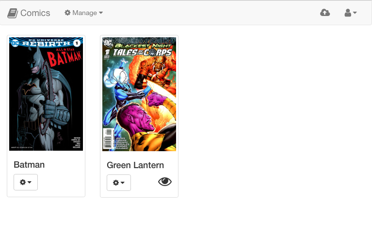
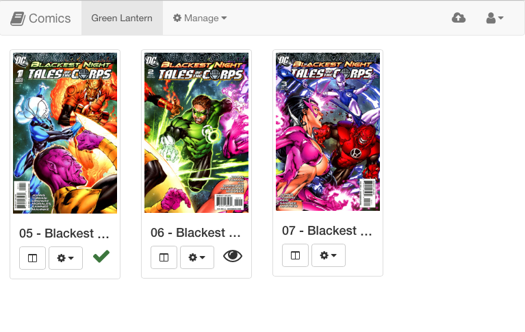
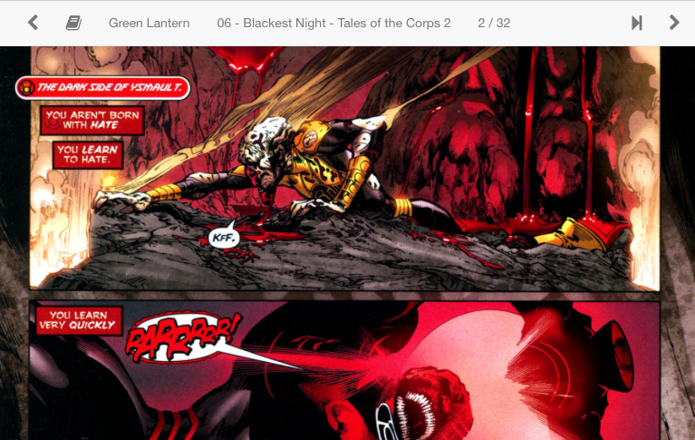

# Comics

Web based, tablet-first comic reader.





## Features

- Upload CBZ / CBR archives (drag and drop, multiple at once), organized into groups
- Reader with swipe and arrow-key navigation; remembers your place in every comic
- Reading history and per-group disk usage stats
- Multi-user, with an admin panel for managing users

## Requirements

- To build: Go 1.26+ and Node.js 22+

Data is stored in a SQLite database file plus a directory of page images; there's no separate database server to run.

## Building

```
$ make build
```

This builds the frontend (`web/`) and embeds it into a single static binary at `build/comics`. Copy that binary anywhere and run it.

`make release` does a clean build, runs `go vet` and the tests, and writes the binary to `build/comics-vX.Y.Z`. The version comes from the [`VERSION`](VERSION) file; binaries report it with the git commit appended (`comics -version` prints e.g. `0.1.0+271c7ec`).

## Configuration

The server reads `config.yaml` from the first of these locations that exists:

1. `./config.yaml` (the current working directory)
2. The OS config directory, e.g. `$HOME/.config/comics/config.yaml` on Linux,
   `~/Library/Application Support/comics/config.yaml` on macOS

You can also pass a path explicitly with `comics -config /path/to/config.yaml`. See [`config.example.yaml`](config.example.yaml) for all options:

```yaml
listen: ":3000"
database_path: "comics.db"  # SQLite database; relative to the config file
storage_dir: "storage"       # page images; relative to the config file
max_upload_mb: 2048
secure_cookies: false        # set to true behind HTTPS
```

`COMICS_DATABASE_PATH` overrides `database_path` if set. The database is created and migrated automatically on startup.

## Use

Run `./build/comics` and open [http://localhost:3000](http://localhost:3000). On first run you'll be redirected to create the initial admin user.

## Running behind nginx

An example nginx site that proxies `comics.example.com` to the app is in [`contrib/nginx/comics.example.com.conf`](contrib/nginx/comics.example.com.conf). When serving over HTTPS, set `secure_cookies: true`, and consider `listen: "127.0.0.1:3000"` so the app is only reachable through nginx.

## Backups

Back up the storage directory and the database. The database runs in WAL mode, so don't copy `comics.db` while the server is running; take a consistent snapshot with:

```
$ sqlite3 comics.db ".backup comics-backup.db"
```

## Development

Run the Go server and the Vite dev server (with hot reload) in two terminals:

```
$ make dev-backend
$ make dev-frontend
```

Then open [http://localhost:5173](http://localhost:5173). Vite proxies `/api` to the Go server on port 3000.

Run tests with `make test`. `make clean` removes the `build/` directory and the built frontend.
